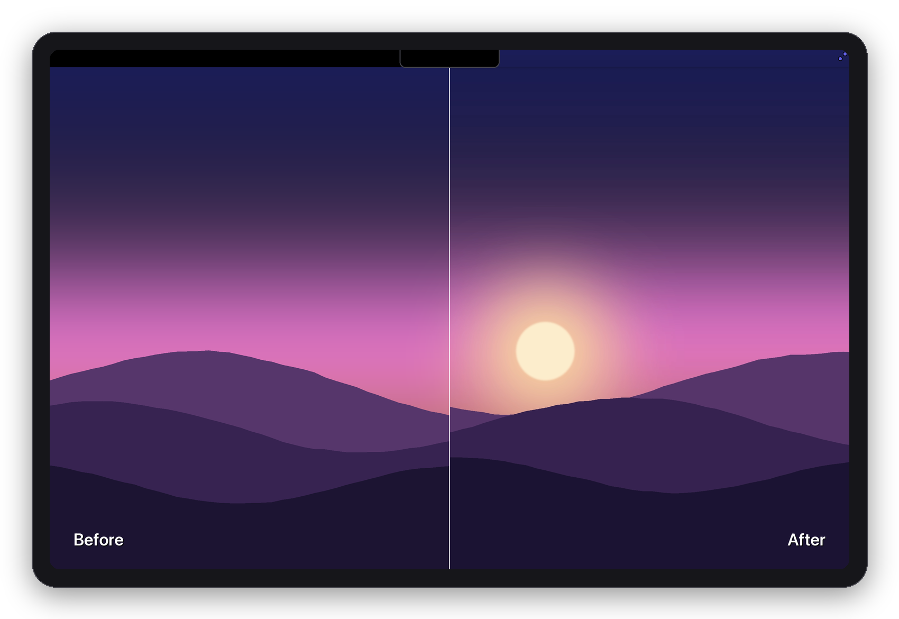
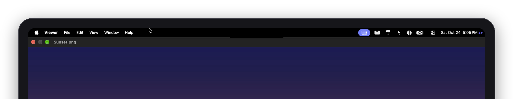
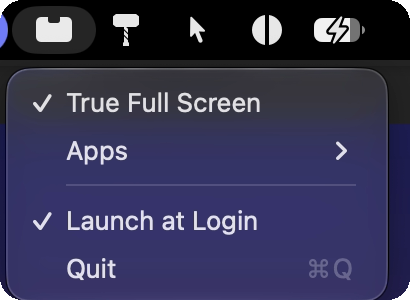

<p align="center">
  
</p>

<h1 align="center">True Full Screen</h1>

<p align="center">
  Full screen on a notched MacBook, all the way to the top.<br><br>
  <a href="https://github.com/Mason363/True-Full-Screen/releases/latest/download/True-Full-Screen.zip"><b>Download</b></a>
</p>



Press the green button as usual. The menu bar and traffic lights still slide in on hover.



<p align="center"></p>

- **True Full Screen** turns it on or off.
- **Apps** lists open apps. Uncheck one to give it normal full screen.

## How

The window moves to a notch-free virtual display the size of your screen, goes full screen there, and that display is shown on yours edge to edge. Nothing runs until a window goes full screen. Inspired by [MacNotchKiller](https://github.com/DTW7607/MacNotchKiller).

## Notes

- Needs Accessibility and Screen Recording.
- macOS shows its screen-recording dot while an app is in true full screen.
- Mission Control and swipes show your other Spaces. ⌘Tab gets you back.
- Idle: 0% CPU, ~15 MB.
- Uses private macOS APIs. Tested on macOS 27.

## Build

```sh
./build.sh
```
